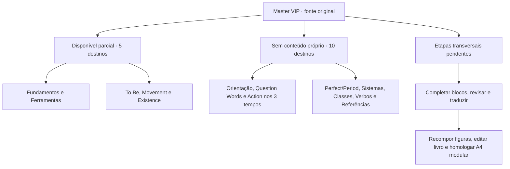

# Master VIP — cobertura do conteúdo

29 de outubro de 2026 · Catálogo 0.12.0 · branch jaguar/master-vip-modular-site-print-20261026.

## Percentual verificável

Aproximadamente **13% do volume textual de origem já está vinculado aos módulos do site**. Métrica por caracteres: **38.743 / 304.836 = 12,71%**. Métrica por parágrafos com texto: **1.604 / 11.072 = 14,49%**. Ambos usam IDs únicos dos parágrafos de origem das unidades ORIGINAL, contando cada parágrafo uma vez. O intervalo de texto de cada parágrafo é o extraído do XML do DOCX; textos repetidos existentes na fonte e alternativas de caixas podem fazer parte do denominador. Não é percentual de páginas nem índice de qualidade.

Antes do MVP10: 22.667 caracteres (7,44%) e 935 parágrafos com texto (8,44%). O bloco Action Versus Movement contém muitos exercícios agregados no mesmo parágrafo; por isso o avanço em caracteres é maior que o avanço em quantidade de parágrafos. A contagem por capítulos disponíveis não mede conclusão de conteúdo.

| Indicador | Disponível/classificado | Total da fonte | Cobertura |
|---|---:|---:|---:|
| Volume textual de origem vinculado | 38.743 caracteres | 304.836 | 12,71% |
| Parágrafos com texto vinculados | 1.604 | 11.072 | 14,49% |
| Parágrafos XML classificados, incluindo vazios | 2.935 | 20.649 | 14,21% |
| Tabelas de origem incorporadas nos blocos | 22 | 168 | 13,10% |
| Arquivos raster distintos preservados nos módulos | 51 | 237 | Reprodução/revisão visual pendente |

Fonte: STRUCTURE-KIND OF WORDS.docx, SHA256 99c63e41b4bb3ad74133dbf8a272993494fcef1cd4cd398b8f0ed2256aaf553c. Detalhes e denominadores em master-vip/data/coverage-report.json. Numerador derivado do catálogo e dos mapas ativos; mapas históricos não são somados novamente. A cobertura refere-se à branch de desenvolvimento, não à main/produção.

## Fluxo editorial e conteúdo

As setas organizam o mapa editorial e os destinos. A navegação de estudo é livre.

## Estado de cada destino

| Destino | Estado | Conteúdo atual ou pendência |
|---|---|---|
| Orientação e itinerário | NÃO INTEGRADO | Conteúdo inicial e orientações de percurso |
| Fundamentos | PARCIAL DISPONÍVEL | Dez classes, cinco funções e ordem de frases; revisão/recomposição abertas |
| Ferramentas da língua | PARCIAL DISPONÍVEL | English Face, auxiliares, Be/Do e mãos; composição integral de English In Your Hand pendente |
| To Be | PARCIAL DISPONÍVEL | Comparação, 25 frases de identificação, 60 exercícios/respostas; QUALITY & STATE, três quadros de ordem das frases e seis conjuntos de exemplos; continuação pendente |
| Question Words | NÃO INTEGRADO | Capítulo próprio; existem remissões e exemplos em outros módulos |
| Movement | PARCIAL DISPONÍVEL | Bloco Action Versus Movement: 4 modelos e 96 exercícios; restante pendente |
| Action · Present | NÃO INTEGRADO | Capítulo próprio; comparações pontuais já aparecem nos módulos disponíveis |
| Action · Future | NÃO INTEGRADO | Conteúdo próprio do capítulo |
| Action · Past | NÃO INTEGRADO | Conteúdo próprio do capítulo |
| Perfect e Period | NÃO INTEGRADO | Conteúdo próprio, preservando terminologia autoral |
| Existence · There + To Be | PARCIAL DISPONÍVEL | Bloco original, tabelas, exercícios/respostas e piloto revisado; homologação aberta |
| Sistemas verbais | NÃO INTEGRADO | Sistematização integral |
| Classes de palavras | NÃO INTEGRADO | Desenvolvimento detalhado; quadro introdutório já existe em Fundamentos |
| Studying Verbs | NÃO INTEGRADO | Léxico/matrizes do bloco original |
| Referências e glossários | NÃO INTEGRADO | Referências, glossários e navegação integral |

Cinco destinos têm conteúdo e dez permanecem planejados. Nenhum deles é declarado como capítulo integralmente homologado. A arquitetura de navegação estar cadastrada para todos os destinos não significa que seu conteúdo esteja importado.

## Etapas transversais ainda abertas

Revisão contextual, tradução integral dos textos originais, revisão tipográfica por trecho, recomposição vetorial e imagens, escalas físicas, mesclagens, paginação e prova física A4. As três provas PDF de Existence são um piloto de cinco páginas por edição, não a apostila inteira. Integração ao Explorer não foi realizada por este projeto; não há autoridade avaliativa ou alteração de D1.

## Próximo elo

P03524 Possessive Pronouns e conteúdos seguintes: delimitar antes de importar. Continuar com IDs de origem, módulos próprios, preservação textual e propostas editoriais explícitas. As dez áreas pendentes acima são o roteiro cadastrado; seus limites integrais ainda precisam de conferência na fonte.

MVP12 acrescenta 253 parágrafos XML classificados (129 com texto vinculado), 1.401 caracteres, uma tabela, oito ocorrências de imagens (sete arquivos novos) e cinco composições XML preservadas. Catálogo: 399 unidades. Composição visual de camadas permanece pendente; percentual textual não mede prontidão gráfica.

Atualização MVP13: P02683–P02794, 112 parágrafos XML (37 com texto), 2.159 caracteres adicionais, tabela T0018. 39 unidades novas, 18 ocorrências pedagógicas de imagem e um pixel técnico separado. Catálogo atual 0.11.0: 438 unidades, 1.820 alvos speech. 51 arquivos raster pedagógicos distintos preservados; pixel técnico excluído desse numerador. Composições e revisão contextual seguem pendentes.

Atualização MVP14: P02795–P03523, 729 parágrafos XML (473 com texto), 4.015 caracteres adicionais, tabelas T0019/T0020. 105 módulos novos: 50 fichas de speaking, 50 itens de construção (dois modelos resolvidos e 48 exercícios sem respostas fornecidas), orientações e remissões. Catálogo atual 0.12.0: 543 unidades e 2.143 alvos speech. Dados históricos e grafias da fonte aguardam revisão humana; sem atualização biográfica implícita.
